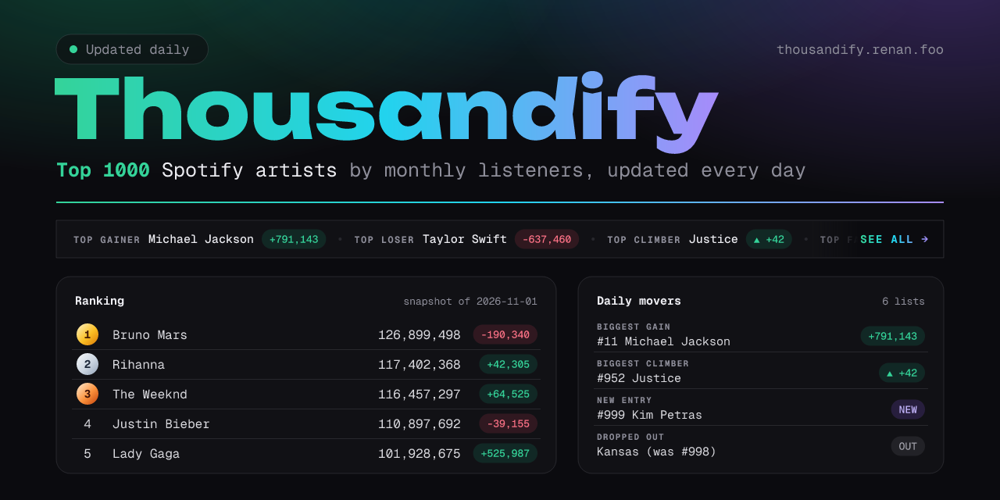

  

  <b>The 1000 most-listened artists on Spotify, ranked by monthly listeners and updated every day.</b>
   
  <a href="https://thousandify.renan.foo"><b>thousandify.renan.foo</b></a>

---

## What you'll find

### 🏆 The ranking

All 1000 artists in one table, from the biggest names down to the ones fighting
to stay in. For each artist you see:

| Column | What it means |
| :-- | :-- |
| **#** | Position today. The top 3 get gold, silver and bronze. |
| **Trend** | How many positions they moved since the previous day, or **NEW** if they just entered. |
| **Listeners** | Monthly listeners: unique people who played them at least once in the last 28 days. |
| **Daily** | How many monthly listeners they gained or lost since the previous day. |

Click any column to sort by it, or press <kbd>/</kbd> to search for an artist.

### 📈 Daily movers

A scrolling bar above the ranking shows the day's top gainer, loser, climber
and faller. The [movers page](https://thousandify.renan.foo/movers) goes deeper,
with six lists:

- **Biggest gains** and **biggest losses** in monthly listeners
- **Biggest climbers** and **biggest fallers** in the ranking
- **New entries**: who made it into the top 1000 today
- **Dropped out**: who fell out, with the position they left from

### 🌗 Light and dark

It follows your system theme, or you can switch it from the header.

## Built with

[Astro](https://astro.build) ·
[Tailwind CSS](https://tailwindcss.com) ·
[Supabase](https://supabase.com) ·
[Vercel](https://vercel.com)

---

  
    Made by <a href="https://github.com/renans2">renans2</a> ·
    <a href="LICENSE">MIT License</a> ·
    Thousandify is an independent project and is not affiliated with Spotify.
  

